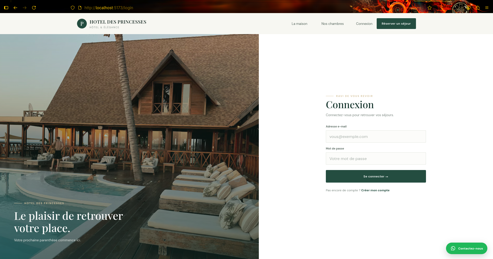
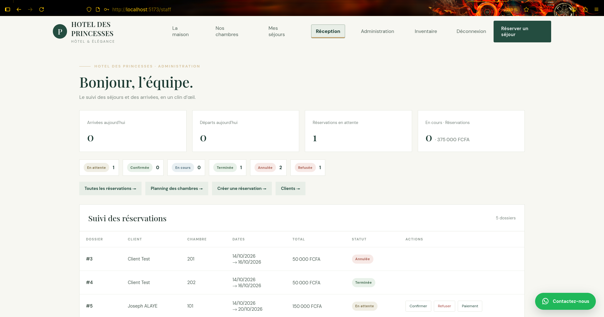
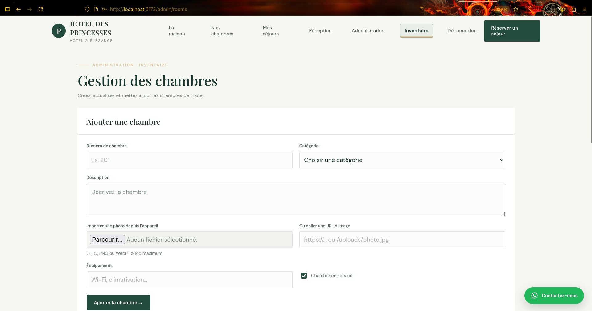

# 🏨 Reservation Hôtel

**Application web de réservation et de gestion hôtelière développée avec NestJS, React et PostgreSQL.**

Reservation Hôtel est une application Full Stack conçue pour faciliter la gestion des réservations d'un établissement hôtelier. Elle permet aux clients de consulter les chambres disponibles et d'effectuer des réservations, tandis que le personnel dispose d'un espace dédié à la gestion des activités de l'hôtel.

## Aperçu de l'application

### Page de connexion



### Tableau de bord administrateur



### Gestion des réservations



## Fonctionnalités

### Client
- Consultation des chambres disponibles.
- Recherche et filtrage des chambres.
- Création d'un compte et authentification.
- Réservation d'une chambre.
- Consultation de ses réservations.
- Suivi du statut des réservations.

### Réceptionniste
- Enregistrement des réservations effectuées sur place.
- Consultation des réservations.
- Suivi des arrivées et des départs.
- Gestion des informations relatives aux clients.

### Administrateur
- Accès au tableau de bord.
- Gestion des utilisateurs.
- Gestion des chambres.
- Gestion des réservations.
- Gestion des catégories de chambres.
- Suivi global de l'activité de l'hôtel.

## Technologies utilisées

### Backend
- **NestJS** : framework Node.js pour le développement de l'API REST.
- **TypeScript** : langage de programmation.
- **TypeORM** : gestion des interactions avec la base de données.
- **PostgreSQL** : système de gestion de base de données.

### Frontend
- **React** : bibliothèque JavaScript pour la création de l'interface utilisateur.
- **Vite** : outil de développement et de compilation.

## Architecture du projet

Le projet est organisé en deux parties indépendantes :

```text
reservation-hotel/
│
├── backend/
│   └── API REST développée avec NestJS
│
├── frontend/
│   └── Interface utilisateur développée avec React
│
├── screenshots/
│   ├── dashbord_admin.png
│   ├── page_connexion.png
│   └── page_gestion.png
│
└── README.md
```

## Installation et configuration

### 1. Prérequis

- Node.js
- npm
- PostgreSQL
- Git

### 2. Cloner le dépôt

```bash
git clone https://github.com/jeanbaptisteassogba87-jpg/reservation-hotel.git

cd reservation-hotel
```

### 3. Installation du backend

```bash
cd backend
npm install
```

Configurer les variables d'environnement nécessaires à la connexion PostgreSQL et au fonctionnement de l'API.

Lancer le serveur en mode développement :

```bash
npm run start:dev
```

### 4. Installation du frontend

Dans un autre terminal :

```bash
cd frontend
npm install
```

Lancer l'application React :

```bash
npm run dev
```

Consulter ensuite l'adresse locale indiquée par Vite dans le terminal.

## Base de données

Le projet utilise **PostgreSQL** pour stocker les informations relatives :

- Aux utilisateurs.
- Aux clients.
- Aux chambres.
- Aux réservations.
- Aux différentes catégories de chambres.

La gestion des entités et des relations entre les données est assurée par TypeORM.

## Objectifs du projet

Ce projet a pour objectifs de mettre en pratique :

- La conception et le développement d'une application Full Stack.
- La création d'une API REST avec NestJS.
- La conception et la gestion d'une base de données relationnelle.
- L'intégration d'un frontend React avec un backend.
- La séparation des responsabilités entre les différentes couches applicatives.
- La gestion des utilisateurs et des rôles.

## Auteur

**Jean-Baptiste ASSOGBA**

Étudiant en Licence 3 — Systèmes Informatiques et Logiciels (SIL).

- GitHub : [jeanbaptisteassogba87-jpg](https://github.com/jeanbaptisteassogba87-jpg)

## Statut du projet

Projet académique réalisé dans le cadre de ma formation en systèmes informatiques et logiciels.

## Licence

Projet académique. Tous droits réservés à l'auteur, sauf indication contraire.
